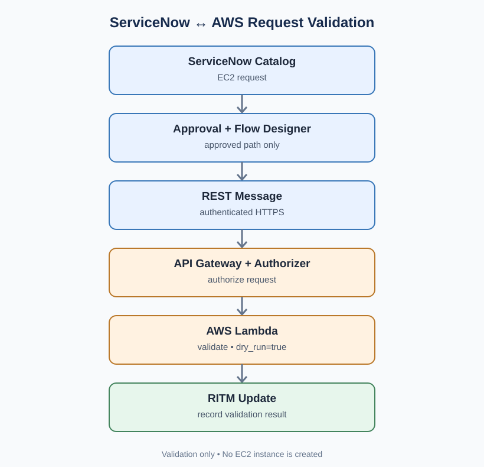
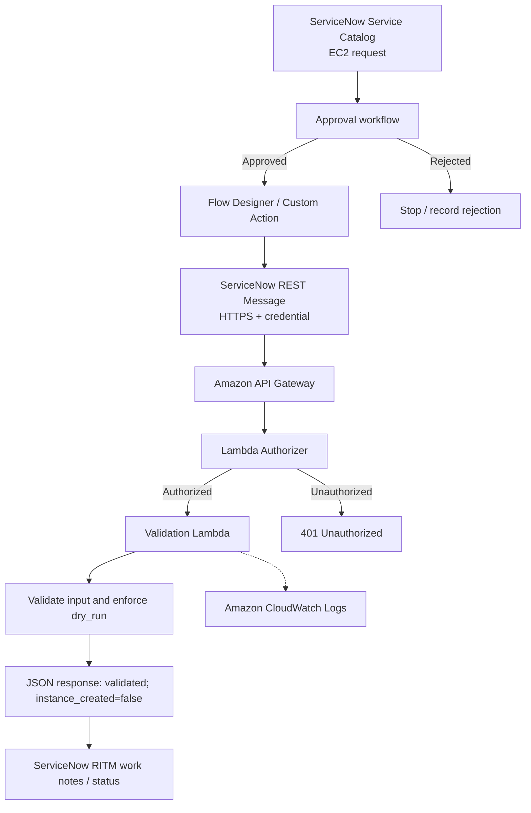
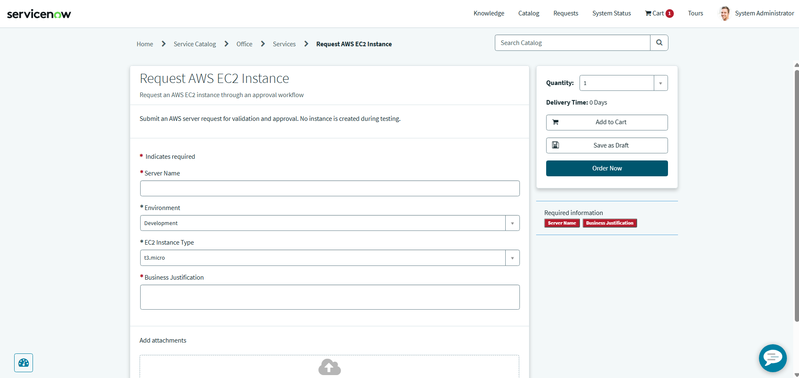
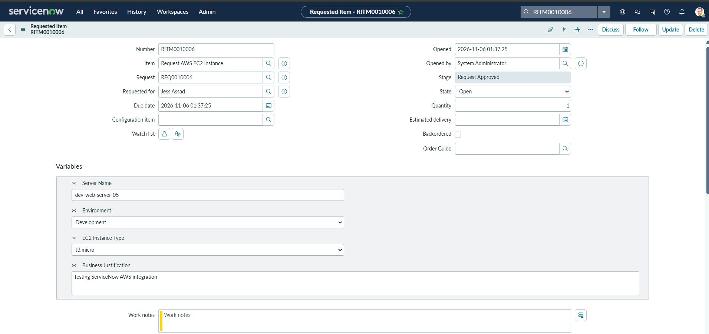
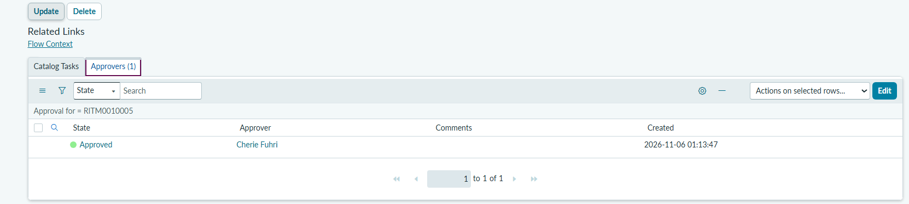
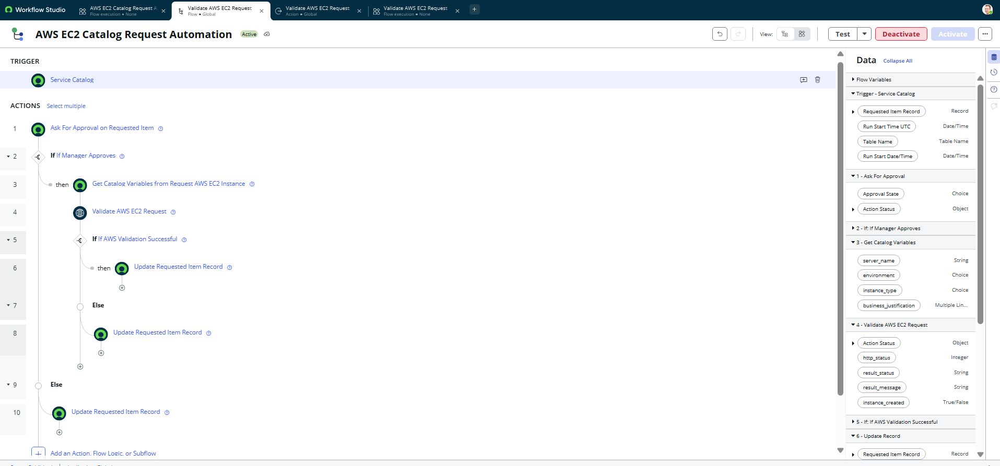
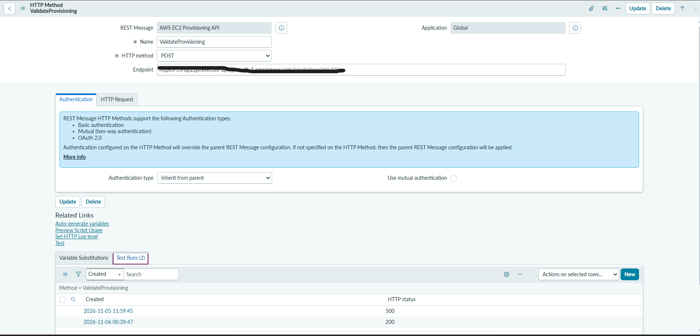
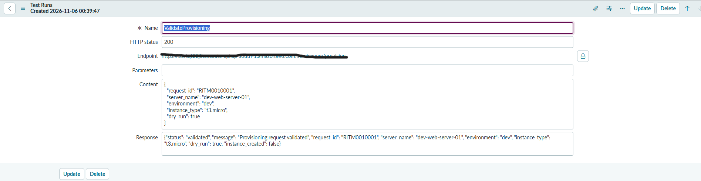
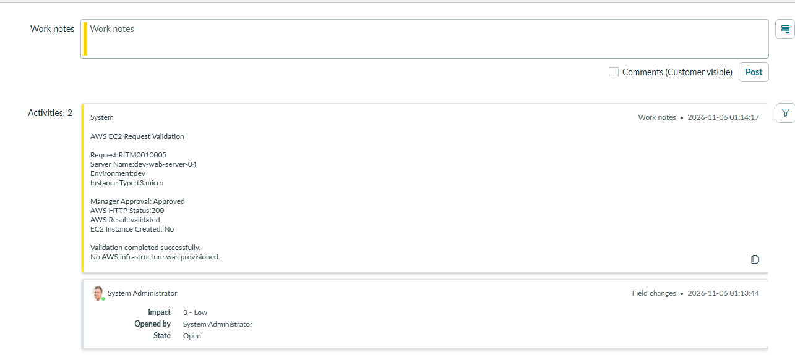

# ServiceNow ↔ AWS | Approval-Driven EC2 Request Validation

  

## Highlights

- **Approval-controlled workflow:** ServiceNow catalog requests pass through approval before the AWS validation call.
- **Authenticated integration:** ServiceNow REST Message communicates with API Gateway through a Lambda authorizer.
- **Safe execution:** The AWS backend runs in validation-only mode; no EC2 instances are created.
- **Traceability:** The design connects AWS validation responses to ServiceNow Requested Item tracking.
- **Inspectable implementation:** Python Lambda handlers, ServiceNow JavaScript, diagrams, and test evidence are included.

## Overview

An approval-driven ServiceNow–AWS integration that accepts EC2 requests through a Service Catalog item, routes them through an approval workflow, and securely submits approved requests to an AWS serverless API for validation. The API returns a structured response that can be recorded against the ServiceNow Requested Item (RITM).

**Safety boundary:** This implementation is intentionally configured for **validation only** (`dry_run: true`). It does **not** provision EC2 instances. This repository demonstrates the integration and request-control workflow, not production-ready infrastructure provisioning.

## Problem Statement

Manual cloud infrastructure requests can involve disconnected forms, approvals, handoffs, and status tracking. This project demonstrates how a ServiceNow catalog request can initiate a controlled AWS validation workflow while preserving a traceable request record.

## Architecture





The approval step gates the outbound request; API Gateway and the Lambda authorizer protect the AWS entry point. The backend validates the request in dry-run mode and returns a response for tracking in ServiceNow.

## Technology Stack

| Layer | Technology | Role |
|---|---|---|
| Request interface | ServiceNow Service Catalog | Capture EC2 request details |
| Workflow | ServiceNow Flow Designer and approvals | Route approved requests |
| Integration | ServiceNow REST Message / scripted action | Call AWS HTTPS API |
| API | Amazon API Gateway | Expose a managed endpoint |
| Authentication | AWS Lambda authorizer | Check the caller's credential |
| Compute | AWS Lambda (Python) | Validate payload and return structured JSON |
| Observability | Amazon CloudWatch | Inspect Lambda execution logs |
| Source control | GitHub | Version and document project artifacts |

## Request Lifecycle

1. A requester submits an EC2 request in ServiceNow with server name, environment, and instance type.
2. ServiceNow creates a Requested Item (RITM).
3. The approval workflow evaluates the request. Only the approved branch calls AWS.
4. Flow Designer invokes a ServiceNow REST Message with an authenticated JSON request.
5. API Gateway invokes the Lambda authorizer, then forwards authorized traffic to the validation Lambda.
6. Lambda validates the fields and enforces the server-side validation-only restriction.
7. AWS responds with validation status and `instance_created: false`.
8. The workflow records the result in the RITM, allowing request-level tracking.

## Example API Contract

Illustrative request (replace the sample RITM number and values for your own tests):

```json
{
  "request_id": "RITM0010001",
  "server_name": "dev-web-server-01",
  "environment": "dev",
  "instance_type": "t3.micro",
  "dry_run": true
}
```

Example successful validation response observed during testing:

```json
{
  "status": "validated",
  "message": "Provisioning request validated",
  "request_id": "RITM0010001",
  "server_name": "dev-web-server-01",
  "environment": "dev",
  "instance_type": "t3.micro",
  "dry_run": true,
  "instance_created": false
}
```

**Expected HTTP status:** `200 OK` for a valid, authorized request. Authentication and input-validation failures should be tested separately; do not assume their exact codes without checking the deployed implementation.

## Security Design

- **Approval gate:** The workflow should invoke AWS only on the approved branch.
- **HTTPS:** ServiceNow sends the API request over TLS.
- **API authentication:** A Lambda authorizer checks the credential before the backend executes.
- **Server-side dry-run enforcement:** The backend must reject or override attempts to request actual provisioning; a UI checkbox alone is not sufficient.
- **Least privilege:** Keep Lambda IAM permissions scoped to what validation requires; avoid granting EC2 creation privileges for a validation-only function.
- **Secret handling:** Store credentials in approved secret/credential stores, never in committed source code or screenshots.
- **Logging:** Use CloudWatch for diagnostics while avoiding sensitive payloads or credentials in logs.

## Validation and Test Evidence

| Test | Expected outcome | Evidence |
|---|---|---|
| Approved catalog request | Approved path invokes integration | `screenshots/03-approval.png`, `04-flow-designer.png` |
| Authorized request | API responds `200` and `validated` | `screenshots/06-api-response.png` |
| Dry-run safety | `instance_created` is `false` | `screenshots/06-api-response.png` |
| RITM status / work notes | Validation outcome recorded | `screenshots/07-ritm-work-notes.png` |
| Rejected approval | AWS integration is not invoked | Add evidence after verifying |
| Invalid credential | Request is denied | Add evidence after verifying |
| `dry_run: false` | Backend cannot create an instance | Add evidence after verifying |

The screenshot filenames above are **placeholders** until real, sanitized evidence is added. Do not claim unexecuted tests have passed.

## Implementation and Evidence

The integration has returned **HTTP 200** with `status: validated`, `dry_run: true`, and `instance_created: false`. Screenshots demonstrate the catalog, request, approval, workflow, REST configuration, response, and RITM notes. The end-to-end approval gate and negative security tests should be independently verified before describing them as fully tested.

### Project screenshots

| Evidence | Screenshot |
|---|---|
| Service Catalog request |  |
| Requested Item |  |
| Approval record |  |
| Flow Designer workflow |  |
| REST Message |  |
| Successful validation response |  |
| RITM work notes |  |

## Source Code

| File | Purpose |
|---|---|
| [EC2 validation Lambda](aws/ec2_validation_lambda.py) | Validates incoming EC2 requests in dry-run mode |
| [Lambda authorizer](aws/lambda_authorizer.py) | Authenticates requests before backend invocation |
| [ServiceNow custom action](servicenow/validate_ec2_request.js) | Builds and sends the REST request, handles response outputs |

## Repository Structure

```text
servicenow-aws-ec2-request-automation/
├── README.md
├── .gitignore
├── aws/
│   ├── ec2_validation_lambda.py
│   └── lambda_authorizer.py
├── servicenow/
│   └── validate_ec2_request.js
├── docs/
│   ├── architecture.svg
│   └── setup-and-testing.md
└── screenshots/
    ├── 01-service-catalog.png
    ├── 02-requested-item.png
    ├── 03-approval.png
    ├── 04-flow-designer.png
    ├── 05-rest-message.png
    ├── 06-api-response.png
    └── 07-ritm-work-notes.png
```

## Setup and Reproduction

See [Setup and testing guide](docs/setup-and-testing.md). This is a project demonstration; configuration varies by ServiceNow instance, AWS account, and authentication setup.

## Engineering Lessons

- Connecting a ServiceNow approval process to a managed AWS API.
- Mapping catalog variables into a structured REST payload.
- Separating API authentication from business validation.
- Designing a safe validation-only boundary before enabling provisioning.
- Tracking API results in ServiceNow and troubleshooting with AWS logs.

## Future Enhancements

- Add automated negative tests for rejection, authorization, and dry-run enforcement.
- Introduce controlled EC2 provisioning behind additional policy, IAM, and cost safeguards.
- Add idempotency and retry handling to prevent duplicate actions.
- Implement richer request status transitions and monitoring alerts.

## Implementation Status

**Working ServiceNow-to-AWS request validation integration.** The demonstrated response confirms successful validation without creating EC2 resources (`instance_created: false`). Actual EC2 provisioning is intentionally out of scope.

## Author

**Ayush Kamble**  
ServiceNow Developer | AWS Cloud & Automation  
GitHub: [@Aayush024](https://github.com/Aayush024)
